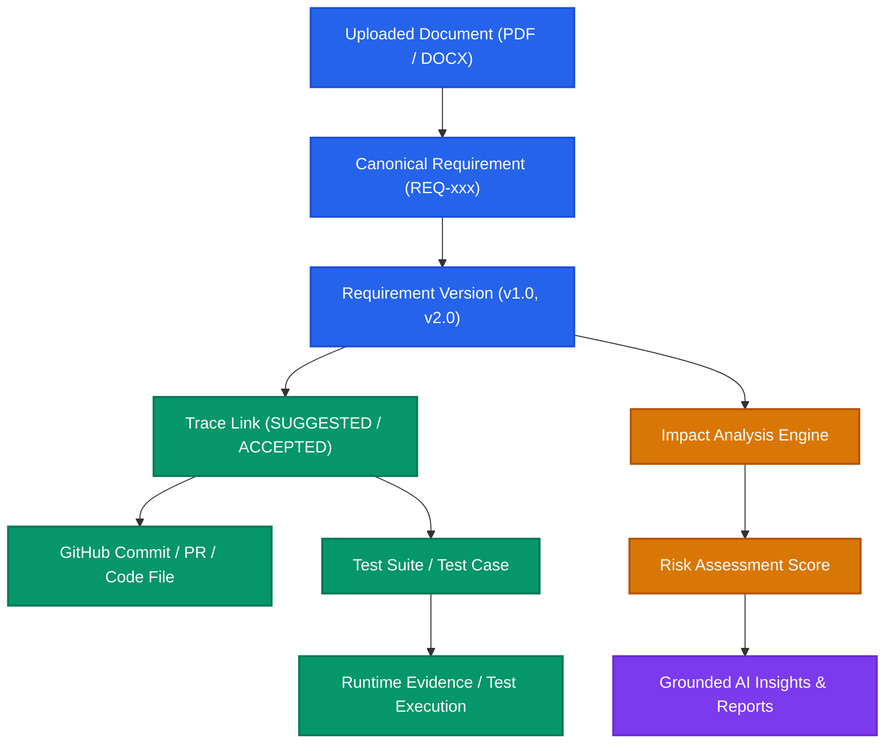
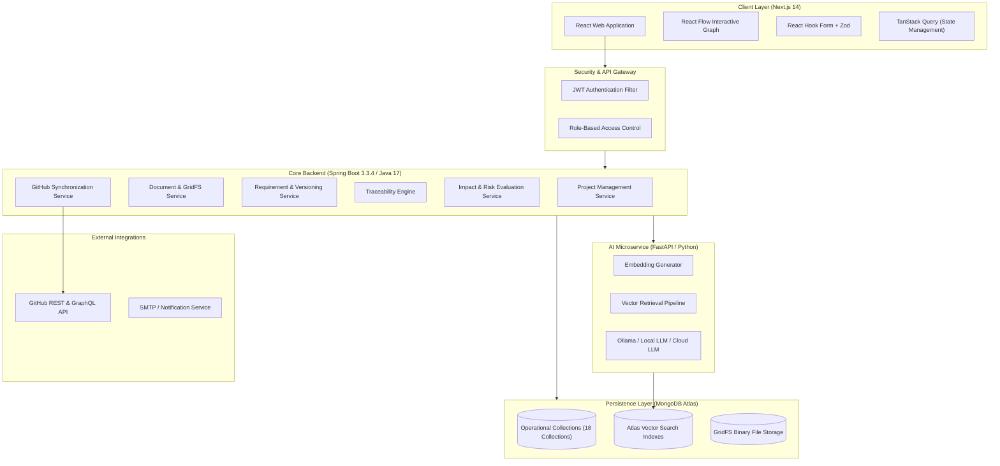

# 🔍 ReqTrace AI

<p align="center">
  <strong>Evidence-Grounded Requirements Traceability, Change Impact Analysis & Intelligent Software Engineering Platform</strong>
</p>

<p align="center">
  
  
  
  
  
  
  
  
</p>

---

## 📑 Table of Contents

1. [Executive Overview](#-executive-overview)
2. [Core Architecture Principles](#-core-architecture-principles)
3. [Key System Features](#-key-system-features)
4. [End-to-End Traceability Model](#-end-to-end-traceability-model)
5. [System Architecture](#-system-architecture)
6. [Technology Stack](#-technology-stack)
7. [Repository Structure](#-repository-structure)
8. [MongoDB Schema & Collection Baseline](#-mongodb-schema--collection-baseline)
9. [REST API Reference](#-rest-api-reference)
10. [Local Development Setup](#-local-development-setup)
11. [Testing & Quality Assurance](#-testing--quality-assurance)
12. [Collaboration & Team Roster](#-collaboration--team-roster)
13. [Academic & Project Metadata](#-academic--project-metadata)

---

## 🌟 Executive Overview

**ReqTrace AI** is an enterprise-grade, AI-assisted requirements engineering and traceability intelligence platform designed to eliminate requirement drift, undetected code breaks, and opaque project risk.

In modern software development, requirements (Software Requirement Specifications — SRS) are constantly changing. When an SRS specification or user story evolves:
- Codebases often suffer from silent breaking changes.
- Test suites become outdated or miss newly added boundary criteria.
- Developers lack transparent visibility into which GitHub commits, PRs, or APIs are coupled to each requirement.
- Generic LLM tools hallucinate assumptions without evidence grounding.

**ReqTrace AI bridges this gap** by creating an immutable, queryable chain of custody connecting:
$$\text{Requirement} \longrightarrow \text{Version} \longrightarrow \text{Code/PR} \longrightarrow \text{Test} \longrightarrow \text{Evidence} \longrightarrow \text{Impact} \longrightarrow \text{Risk} \longrightarrow \text{AI Insight}$$

---

## 🏛️ Core Architecture Principles

1. **AI Assists; Human Verifies:** AI suggests links and flags inconsistencies, but never silently replaces approved engineering truth.
2. **Immutable Requirement History:** Approved versions of requirements are strictly preserved; history is never overwritten or destroyed.
3. **Deterministic First, Probabilistic Second:** Rule-based logic and explicit references take precedence over AI semantic inferences.
4. **Evidence-Grounded Insights:** Every AI diagnosis, conflict warning, and risk score is backed by direct artifact citations.
5. **Explainable Risk Scoring:** Risk values (Low, Medium, High, Critical) are computed through transparent factors, not black-box assumptions.
6. **Zero Direct Frontend-to-Database Access:** All data interactions pass through hardened, authenticated Spring Boot backend services.

---

## ⚡ Key System Features

### 📄 1. Document Management & Extraction (P3)
- Multi-format ingestion supporting **PDF** and **DOCX** requirement documents.
- Secure storage abstraction using **MongoDB GridFS** and cloud object storage.
- Automated background text extraction pipelines with detailed processing lifecycles (`UPLOADED` ➔ `PROCESSING` ➔ `PROCESSED` / `FAILED`).
- Document metadata indexing (file size, SHA-256 hash, word count, MIME type).

### 🏷️ 2. Requirement Lifecycle & Version Control (P4 & P5)
- Canonical requirement registry with persistent keys (e.g., `REQ-001`, `REQ-002`).
- Sequential, immutable requirement versions (`v1.0`, `v2.0`).
- Granular review, approval, and rejection workflows.
- Visual side-by-side diff comparison between versions.

### 🔗 3. Traceability Matrix & Graph Visualization (P6 & P7)
- Central `trace_links` relational mapping with status tracking:
  - `SUGGESTED` (AI-proposed candidate link)
  - `ACCEPTED` (Human-verified and approved)
  - `REJECTED` (Reviewed and discarded)
- Interactive dynamic dependency graph powered by **React Flow**.
- Traceability coverage metrics identifying orphaned requirements and missing links.

### ⚠️ 4. Quality & Conflict Detection (P8)
- Automated detection across 4 primary issue categories:
  - **CONTRADICTION:** Mutually exclusive functional requirements.
  - **DUPLICATE:** Redundant specifications across documents.
  - **AMBIGUITY:** Non-testable or vague acceptance criteria.
  - **INCONSISTENCY:** Mismatched terminology, types, or scopes.
- Rule-based heuristics combined with embedding similarity checks.

### 🐙 5. GitHub Repository Integration & Intelligence (P9 & P10)
- Deep synchronization with GitHub repositories: commits, branches, pull requests, and contributors.
- Automatic commit-to-requirement matching via regex parsing and semantic correlation.
- Development activity metrics and change velocity tracking per requirement.

### 💥 6. Change Impact & Transitive Dependency Analysis (P11)
- Automated impact radius calculation upon requirement modification:
  - Direct trace links affected.
  - Transitive code dependencies and modified files.
  - Affected test cases and coverage gaps.
  - Affected GitHub PRs and developer assignments.
- Exportable audit reports and visual impact trees.

### 🎯 7. Explainable Risk Assessment (P12)
- Transparent algorithmic risk scoring:
  $$\text{Risk Score} = f(\text{Impact Scope}, \text{Test Coverage}, \text{Code Churn}, \text{Conflict Severity})$$
- Categorized risk levels: `LOW`, `MEDIUM`, `HIGH`, `CRITICAL`.
- Actionable mitigation recommendations generated alongside risk factors.

### 🤖 8. Grounded AI Assistant & Vector Search (P14)
- **MongoDB Atlas Vector Search** for semantic indexing of requirements, documents, and code artifacts.
- Retrieval-Augmented Generation (RAG) powered by **FastAPI** and local/cloud LLMs (Ollama / Gemini).
- Strict project-scoped retrieval guaranteeing zero cross-tenant data leakage.
- Citations returned with every answer pointing to exact document sections and code blocks.

---

## 🔄 End-to-End Traceability Model



---

## 🏗️ System Architecture



---

## 🛠️ Technology Stack

| Domain | Technology | Version | Purpose |
| :--- | :--- | :--- | :--- |
| **Frontend Framework** | Next.js (App Router) | 14.x | React framework, SSR, and dynamic client routing |
| **Frontend Language** | TypeScript | 5.x | End-to-end type safety |
| **Styling & UI** | Tailwind CSS + shadcn/ui | 3.4+ | Utility-first styling & accessible UI components |
| **Graph Visualization** | React Flow | 11.x | Interactive traceability & impact graph visualization |
| **Client State / Cache** | TanStack Query | 5.x | Server-state caching and synchronization |
| **Core Backend** | Spring Boot | 3.3.4 | RESTful enterprise backend services |
| **Backend Language** | Java (JDK) | 17 LTS | Core server runtime |
| **Security** | Spring Security + JWT | 6.x | Stateless JWT authentication, RBAC, and ownership guards |
| **Primary Database** | MongoDB Atlas | 7.0+ | Distributed document database & GridFS binary storage |
| **Vector Search** | MongoDB Atlas Vector Search | Native | Semantic requirement search and context retrieval |
| **AI Microservice** | FastAPI | 0.110+ | High-performance Python async API for LLM orchestration |
| **AI / Embeddings** | Sentence-Transformers / Ollama | Latest | Local & cloud-assisted embeddings and grounded RAG |
| **Build & Testing** | Maven 3.9+, JUnit 5, Mockito | Latest | Automated build verification and unit testing |

---

## 📂 Repository Structure

```text
ReqTrace AI/
├── backend/                               # Spring Boot Java 17 Application
│   ├── src/
│   │   ├── main/
│   │   │   ├── java/com/nova/emergency/   # (Core package namespace)
│   │   │   │   ├── config/                # MongoConfig, SecurityConfig, GridFSConfig
│   │   │   │   ├── controller/            # REST Controllers (Auth, Project, Document, Req)
│   │   │   │   ├── dto/                   # Request/Response Data Transfer Objects
│   │   │   │   ├── exception/             # GlobalExceptionHandler and Custom Exceptions
│   │   │   │   ├── model/                 # MongoDB Document Entities (User, Project, Document...)
│   │   │   │   ├── repository/            # Spring Data MongoDB Repositories
│   │   │   │   ├── security/              # JwtFilter, JwtUtil, UserDetailsService
│   │   │   │   └── service/               # Core business logic implementations
│   │   │   └── resources/
│   │   │       ├── application.properties # Server, database & security configuration
│   │   │       └── templates/             # Email & notification templates
│   │   └── test/                          # Unit and integration test suites (JUnit 5 & Mockito)
│   └── pom.xml                            # Maven project configuration & dependencies
│
├── frontend/                              # Next.js 14 TypeScript Application
│   ├── src/
│   │   ├── app/                           # App router pages (dashboard, projects, trace-matrix)
│   │   ├── components/                    # UI elements, buttons, modals, navigation
│   │   ├── features/                      # Feature modules (documents, requirements, impact)
│   │   ├── lib/                           # API client (Axios/Fetch), utility functions
│   │   ├── hooks/                         # Custom React hooks
│   │   └── types/                         # TypeScript interfaces and contracts
│   ├── public/                            # Static assets, branding, and icons
│   ├── package.json                       # Frontend dependencies and scripts
│   └── tailwind.config.ts                 # Tailwind CSS styling configuration
│
├── ai-service/                            # FastAPI Python AI Microservice
│   ├── app/
│   │   ├── api/                           # API endpoints for vector search & generation
│   │   ├── services/                      # Document chunking, embedding, and inference
│   │   ├── retrieval/                     # Atlas Vector Search retrieval pipelines
│   │   └── models/                        # Pydantic schemas
│   ├── requirements.txt                   # Python dependencies (FastAPI, PyMuPDF, etc.)
│   └── main.py                            # Application entry point
│
├── Documents/                             # Architecture blueprints, SRS & documentation
│   ├── ReqTrace_AI_SRS.docx               # Software Requirement Specifications
│   ├── blueprint_text.txt                 # Working Master Blueprint & Phase Checklist
│   └── ReqTrace_AI_MongoDB_Architecture.docx
│
└── README.md                              # Master project documentation
```

---

## 🗄️ MongoDB Schema & Collection Baseline

The ReqTrace AI database architecture operates on **18 specialized MongoDB collections**:

| # | Collection Name | Purpose & Contents |
| :---: | :--- | :--- |
| **1** | `users` | User credentials, roles, email verification status, and audit metadata. |
| **2** | `projects` | Project workspaces, owners, active/archived state, and timestamps. |
| **3** | `documents` | Uploaded SRS documents (PDF/DOCX), metadata, hash, and extraction status. |
| **4** | `requirements` | Canonical requirements (e.g., `REQ-001`), descriptions, priorities, types. |
| **5** | `requirement_versions`| Immutable historical snapshots of requirements with change summaries. |
| **6** | `artifacts` | Normalized software artifacts (source files, endpoints, components). |
| **7** | `trace_links` | Relational links connecting requirements to artifacts (`SUGGESTED`, `ACCEPTED`, `REJECTED`). |
| **8** | `github_repositories` | Connected GitHub repositories and authentication metadata. |
| **9** | `github_branches` | Synchronized repository branches. |
| **10**| `github_commits` | Commits, commit messages, author metadata, and touched files. |
| **11**| `github_pull_requests`| Pull request states, reviews, merged timestamps, and linked issues. |
| **12**| `github_contributors` | Contributor activity metrics and commit frequency. |
| **13**| `tests` | Unit, integration, and E2E test definitions linked to requirements. |
| **14**| `evidence` | Test run outputs, CI logs, coverage reports, and runtime proof. |
| **15**| `conflicts` | Contradictions, duplicates, ambiguities, and inconsistencies. |
| **16**| `impact_analyses` | Impact reports, affected artifacts, and transitive dependency paths. |
| **17**| `risk_assessments` | Algorithmic risk scores (`LOW`–`CRITICAL`), risk factors, and explanations. |
| **18**| `audit_logs` | Immutable audit trail for compliance, approvals, and security-critical actions. |

---

## 📡 REST API Reference

### 🔐 1. Authentication & Users (`/api/auth`)
- `POST /api/auth/register` — Register a new user account.
- `POST /api/auth/login` — Authenticate credentials and receive a JWT token.
- `GET /api/auth/me` — Retrieve the profile of the authenticated user.
- `POST /api/auth/verify-otp` — Verify user email address with OTP.
- `POST /api/auth/resend-otp` — Resend verification OTP code.

### 📁 2. Project Management (`/api/projects`)
- `GET /api/projects` — List all accessible projects for the authenticated user.
- `POST /api/projects` — Create a new project workspace.
- `GET /api/projects/{id}` — Fetch detailed project information.
- `PUT /api/projects/{id}` — Update project title, description, or status.
- `DELETE /api/projects/{id}` — Archive or delete a project.

### 📄 3. Document Management (`/api/projects/{id}/documents`)
- `POST /api/projects/{id}/documents` — Upload a new PDF/DOCX requirement file.
- `GET /api/projects/{id}/documents` — List all documents belonging to a project.
- `GET /api/projects/{id}/documents/{docId}` — Retrieve document metadata and processing status.
- `DELETE /api/projects/{id}/documents/{docId}` — Remove a document and its parsed content.

### 📋 4. Requirements & Versioning (`/api/projects/{id}/requirements`)
- `GET /api/projects/{id}/requirements` — Retrieve canonical requirements list.
- `POST /api/projects/{id}/requirements` — Create a new requirement entry.
- `GET /api/requirements/{id}` — Fetch full requirement details.
- `PUT /api/requirements/{id}` — Update requirement content (creates new version).
- `GET /api/requirements/{id}/versions` — Fetch complete immutable version history.
- `POST /api/versions/{versionId}/approve` — Approve a pending requirement version.
- `POST /api/versions/{versionId}/reject` — Reject a pending requirement version.

### 🕸️ 5. Traceability & Impact Analysis
- `GET /api/projects/{id}/trace-links` — Retrieve active and suggested trace links.
- `POST /api/trace-links` — Manually create a trace relationship.
- `POST /api/trace-links/{id}/accept` — Accept an AI-suggested trace link.
- `POST /api/trace-links/{id}/reject` — Reject an AI-suggested trace link.
- `GET /api/projects/{id}/traceability/matrix` — Fetch full Traceability Matrix data.
- `GET /api/projects/{id}/traceability/graph` — Fetch React Flow node-edge graph data.
- `POST /api/requirements/{id}/impact-analysis` — Trigger change impact analysis.
- `GET /api/impact-analyses/{id}` — Retrieve calculated impact scope and risk score.

---

## 💻 Local Development Setup

### Prerequisites
- **Java JDK 17** or higher
- **Apache Maven 3.9+**
- **Node.js 18+** & **npm**
- **Python 3.10+** (for AI Microservice)
- **MongoDB Atlas** account or local MongoDB instance

---

### Step 1: Clone the Repository
```bash
git clone https://github.com/Sathurjanv23/AI-Emergency-Response-Network.git reqtrace-ai
cd reqtrace-ai
```

---

### Step 2: Configure & Run the Backend (Spring Boot)
1. Navigate to the backend directory:
   ```bash
   cd backend
   ```
2. Verify `src/main/resources/application.properties`:
   ```properties
   server.port=8080
   spring.application.name=reqtrace-backend
   spring.data.mongodb.uri=${MONGODB_URI:mongodb+srv://<user>:<password>@cluster.mongodb.net}
   spring.data.mongodb.database=reqtrace_ai
   jwt.secret=${JWT_SECRET:YourSuperSecretJwtKeyWithSufficientEntropy12345}
   ```
3. Build and execute tests:
   ```bash
   mvn clean test
   ```
4. Start the application:
   ```bash
   mvn spring-boot:run
   ```
   *Backend will run at:* `http://localhost:8080`  
   *Actuator Health Check:* [http://localhost:8080/actuator/health](http://localhost:8080/actuator/health)

---

### Step 3: Configure & Run the Frontend (Next.js)
1. Open a new terminal and navigate to the frontend directory:
   ```bash
   cd ../frontend
   ```
2. Install dependencies:
   ```bash
   npm install
   ```
3. Set up environment variables (`.env.local`):
   ```env
   NEXT_PUBLIC_API_BASE_URL=http://localhost:8080/api
   ```
4. Start the development server:
   ```bash
   npm run dev
   ```
   *Frontend will run at:* [http://localhost:3000](http://localhost:3000)

---

### Step 4: Run the AI Microservice (FastAPI)
1. Navigate to the AI service directory:
   ```bash
   cd ../ai-service
   ```
2. Set up virtual environment and install dependencies:
   ```bash
   python -m venv venv
   source venv/bin/activate  # Windows: venv\Scripts\activate
   pip install -r requirements.txt
   ```
3. Launch the FastAPI server:
   ```bash
   uvicorn main:app --reload --port 8000
   ```
   *AI Microservice Swagger Docs:* [http://localhost:8000/docs](http://localhost:8000/docs)

---

## 🧪 Testing & Quality Assurance

ReqTrace AI maintains strict test verification standards. Code is only merged after passing all unit, integration, and security checks.

### Running Backend Tests
```bash
cd backend
mvn clean test
```
*Current test suite status:* **51 passing unit & integration tests** covering Authentication, Incident & Project controllers, Document models, and Service layers with 0 failures.

### Definition of Done (DoD)
Every functional slice must satisfy:
- [x] REST API contract implemented and documented.
- [x] Spring Boot service & MongoDB repository with compound indexing.
- [x] Server-side authentication and project-scope authorization verified.
- [x] Comprehensive unit & mock tests executed.
- [x] Co-author attribution applied to every commit.

---

## 👥 Collaboration & Team Roster

ReqTrace AI is developed under an equal full-stack rotating collaboration model:

<table align="center">
  <tr>
    <td align="center" width="50%">
      <h3>👨‍💻 Sathurjan Vijithsakumarasena</h3>
      <p><strong>Role:</strong> Full-Stack Engineer / Lead Architect</p>
      <p>📧 <a href="mailto:sathurjanv.23@uom.lk">sathurjanv.23@uom.lk</a></p>
      <p>GitHub: <a href="https://github.com/Sathurjanv23">@Sathurjanv23</a></p>
      <p><em>Primary Focus:</em> Backend Infrastructure, Document Processing, Impact Engine, Vector Search & Graph APIs.</p>
    </td>
    <td align="center" width="50%">
      <h3>👨‍💻 Januka Karunakaran</h3>
      <p><strong>Role:</strong> Full-Stack Engineer / Technical Reviewer</p>
      <p>📧 <a href="mailto:karunakaranj.23@uom.lk">karunakaranj.23@uom.lk</a></p>
      <p>GitHub: <a href="https://github.com/januka-karunakaran">@januka-karunakaran</a></p>
      <p><em>Primary Focus:</em> UI/UX Engineering, Project Management, Quality Detection, Auth Verification & AI Integration.</p>
    </td>
  </tr>
</table>

### Mandatory Git Commit Convention
Every collaborative commit includes explicit Git trailers for co-authorship:
```git
feat(<module>): <descriptive imperative summary>

Co-authored-by: januka-karunakaran <karunakaranj.23@uom.lk>
```

---

## 🎓 Academic & Project Metadata

- **Institution:** University of Moratuwa (UoM)
- **Project Domain:** Software Engineering, AI/ML, Requirements Traceability (RE/SE)
- **Specification Blueprint:** ReqTrace AI Execution Blueprint v1.0
- **License:** Proprietary University Academic Project

<p align="center">
  <sub>Built with ❤️ by Sathu & Janu — ReqTrace AI Engineering Team</sub>
</p>
