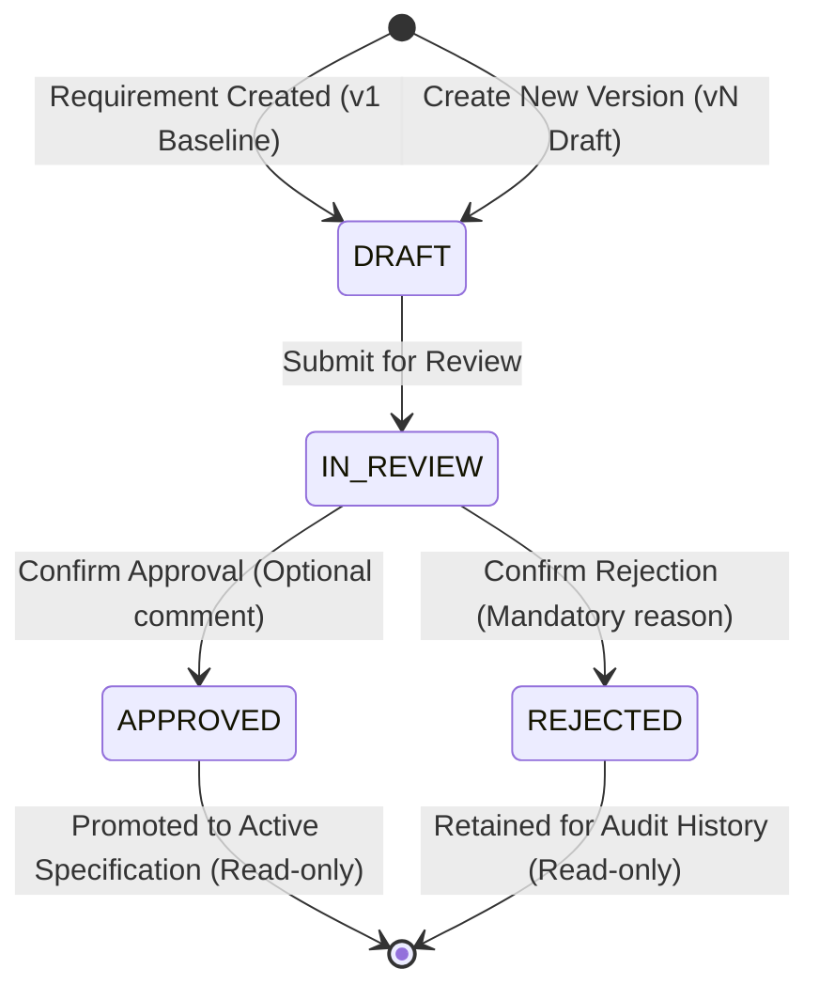

# ReqTrace AI — Feature 05.2: Requirement Versioning & Evolution Workflow

## 1. Feature Overview
ReqTrace AI provides an AI-powered requirement evolution, traceability, and change-impact intelligence platform. Feature 05.2 establishes the end-to-end frontend and backend requirement versioning workflow, allowing software engineering teams to:
- Trace requirements chronologically from their initial draft baseline through successive iterations.
- Propose new draft versions without mutating historical or currently approved requirement baselines.
- Conduct formal review transitions (`DRAFT` ➔ `IN_REVIEW` ➔ `APPROVED` or `REJECTED`).
- Promote approved version snapshots into the active specification.
- Inspect and audit rejected versions alongside required reviewer feedback.
- Perform side-by-side visual diff comparisons between any two historical versions using token-level Longest Common Subsequence (LCS) analysis.

---

## 2. Architecture & Involved Components

### A. Backend Architecture (Spring Boot 3.3.4 & MongoDB Atlas)
- **`Requirement.java`**: Parent requirement document tracking key metadata, current status, and `currentVersionId` pointing to the active specification snapshot.
- **`RequirementVersion.java`**: Immutable historical snapshot storing `versionNumber`, `title`, `description`, `changeSummary`, `changeType`, `reviewStatus`, `createdBy`, `reviewedBy`, `approvedBy`, `reviewComment`, and audit timestamps.
- **`RequirementVersionService.java`**: Core service handling version creation, safe sequential version number allocation with optimistic concurrency retries, review status transitions, and cross-document compensation rollbacks.
- **`RequirementVersionComparisonService.java`**: LCS token-level diff engine comparing text fields (`title`, `description`) and categorical fields (`changeType`, `reviewStatus`).
- **`RequirementVersionController.java`**: REST API controller exposing version management, review transitions, and comparison endpoints under `/api/projects/{projectId}/requirements/{requirementId}/versions`.

### B. Frontend Architecture (Next.js 14 App Router, TypeScript, Tailwind CSS)
- **`RequirementDetailsView.tsx`**: Tabbed interface hosting the "Specification" and "Version History" tabs, ensuring instant real-time synchronization upon version approval.
- **`RequirementVersionTimeline.tsx`**: Vertical audit trail timeline rendering chronological version cards (newest-first) with truthful status badges and contextual actions.
- **`CreateRequirementVersionForm.tsx`**: Modal dialog for proposing draft versions, pre-populating from the latest approved snapshot with inline validation.
- **`RequirementVersionReviewActions.tsx`**: Context-aware review actions (`Submit for Review`, `Approve Version`, `Reject Version`) with confirmation modals and validation.
- **`RequirementVersionComparison.tsx`**: Side-by-side dual-column comparison viewer with version selectors, token-level diff highlight chips (`+ Added`, `- Removed`), and out-of-order response protection.
- **`lib/api/requirementVersions.ts`**: Strongly typed API client handling all versioning operations, parameter encoding, and JWT authentication.

---

## 3. Version Lifecycle & State Machine



### Transition Invariants
- `DRAFT ➔ IN_REVIEW`: Only drafts can be submitted for review. Direct approval or rejection from `DRAFT` is rejected (HTTP 409).
- `IN_REVIEW ➔ APPROVED`: Promotes version to active approved specification; updates parent `Requirement` (`title`, `description`, `currentVersionId`, `status = APPROVED`).
- `IN_REVIEW ➔ REJECTED`: Marks version as rejected and permanently logs mandatory reviewer feedback; parent `Requirement` remains unaltered.
- Terminal States: `APPROVED` and `REJECTED` are terminal. Repeated approval, repeated rejection, or direct resubmission is strictly rejected (HTTP 409).

---

## 4. REST API Endpoints

All endpoints are scoped under:
`/api/projects/{projectId}/requirements/{requirementId}/versions`

| Method | Endpoint | Description | Request Body | Response Wrapper |
|---|---|---|---|---|
| `GET` | `/` | Retrieve version history (newest first) | None | `ApiResponse<List<RequirementVersionResponse>>` |
| `GET` | `/{versionNumber}` | Retrieve specific version snapshot | None | `ApiResponse<RequirementVersionResponse>` |
| `POST` | `/` | Create new draft requirement version | `CreateRequirementVersionRequest` | `ApiResponse<RequirementVersionResponse>` |
| `POST` | `/{versionNumber}/submit` | Submit draft version for review | None | `ApiResponse<RequirementVersionResponse>` |
| `POST` | `/{versionNumber}/approve` | Approve in-review version | `ApproveRequirementVersionRequest` (optional) | `ApiResponse<RequirementVersionResponse>` |
| `POST` | `/{versionNumber}/reject` | Reject in-review version | `RejectRequirementVersionRequest` (mandatory) | `ApiResponse<RequirementVersionResponse>` |
| `GET` | `/compare?from={f}&to={t}` | Side-by-side LCS token diff | None (Query Params) | `ApiResponse<RequirementVersionComparisonResponse>` |

---

## 5. DTO Schemas & Request/Response Examples

### A. Create Draft Version
**`POST /api/projects/proj-100/requirements/req-001/versions`**
```json
{
  "title": "Bi-Directional Requirement Traceability Engine",
  "description": "System automatically correlates requirements with Git commit SHAs and automated test runs.",
  "changeSummary": "Clarified commit correlation semantics and test reporting.",
  "changeType": "UPDATED"
}
```

### B. Approve Version
**`POST /api/projects/proj-100/requirements/req-001/versions/2/approve`**
```json
{
  "reviewComment": "Approved following architectural review and test validation."
}
```

### C. Reject Version
**`POST /api/projects/proj-100/requirements/req-001/versions/2/reject`**
```json
{
  "reviewComment": "Rejection: Performance benchmarks on high-frequency commit streams need elaboration."
}
```

### D. Version Comparison Response
**`GET /api/projects/proj-100/requirements/req-001/versions/compare?from=1&to=2`**
```json
{
  "success": true,
  "message": "Success",
  "data": {
    "requirementId": "req-001",
    "fromVersion": 1,
    "toVersion": 2,
    "hasChanges": true,
    "changedFields": [
      {
        "field": "title",
        "oldValue": "Requirement Traceability",
        "newValue": "Bi-Directional Requirement Traceability Engine",
        "addedText": ["Bi-Directional", "Engine"],
        "removedText": []
      },
      {
        "field": "reviewStatus",
        "oldValue": "DRAFT",
        "newValue": "APPROVED",
        "addedText": ["APPROVED"],
        "removedText": ["DRAFT"]
      }
    ],
    "unchangedFields": ["description", "changeType"]
  }
}
```

---

## 6. End-to-End User Journey

1. **Requirement Creation & Baseline Initialization:**
   When an authorized user creates a requirement, the backend atomically initializes Baseline Version 1 (`versionNumber = 1`, `changeType = CREATED`, `reviewStatus = DRAFT`). The parent `Requirement.currentVersionId` points to this baseline.
2. **Version History Timeline:**
   User navigates to the requirement details and opens the "Version History" tab. The timeline displays all snapshots ordered newest-first with truthful status badges (`● Current Draft Pointer` vs `★ Active Approved`).
3. **Proposing a New Draft:**
   Clicking `"Create New Version"` opens a modal pre-populated from the latest approved snapshot (or draft baseline). The user specifies Title (max 200), Change Classification (`UPDATED`, `CLARIFIED`, `CORRECTED`), Change Summary (max 1000), and Specification Description (max 5000). The backend allocates `versionNumber = 2` in `DRAFT` status.
4. **Submitting for Review:**
   The user clicks `"Submit for Review"` on Draft Version 2. The confirmation modal transitions its status to `IN_REVIEW`.
5. **Review Decision (Approve / Reject):**
   - **Approval:** Project owner clicks `"Approve Version"`. Upon approval, Version 2 becomes `APPROVED`, and the parent requirement promotes Version 2's title, description, and status to `APPROVED`. The Specification tab and timeline update in real time.
   - **Rejection:** If rejected with mandatory feedback, Version 2 becomes `REJECTED`. It remains permanently visible in the version audit trail with reviewer feedback; the active approved specification remains untouched.
6. **Side-by-Side Diff Comparison:**
   Users click `"Compare Versions"` in the header or `"Diff vs v1"` on Version 2's card. The side-by-side view visually highlights additions (`+ Added` green chips) and deletions (`- Removed` red strikethrough chips).

---

## 7. Active Approved Version Semantics & Consistency

- **`Requirement.currentVersionId` Semantics:**
  Identifies the active specification snapshot pointer on the parent requirement. At creation, it points to baseline version 1. Upon version approval, it points to the promoted approved version.
- **Truthful Status Representation:**
  A version is only decorated with the `★ Active Approved` badge if `version.reviewStatus === 'APPROVED' && version.id === currentVersionId`. Unapproved drafts pointing to baseline are explicitly badged as `● Current Draft Pointer`.
- **Prepopulation Strategy:**
  When drafting a new version, fields pre-populate from the latest snapshot having `reviewStatus === 'APPROVED'`. If no version has been approved yet, it falls back to the current requirement baseline.
- **Stale Approval Guard:**
  The backend strictly blocks approving an older version if a newer version has already been approved (`InvalidStatusTransitionException: Stale version approval rejected`).
- **Snapshot Immutability:**
  Historical snapshots are never modified or deleted. Creating or rejecting versions does not alter past snapshots.

---

## 8. Error Handling & Edge Cases

| HTTP Status | Error Code / Cause | User-Facing Resolution |
|---|---|---|
| `400` | Validation failure (e.g. blank title, missing rejection comment) | Clear inline field errors and character counter warnings. |
| `401` | Missing or expired JWT token | Redirect prompt to sign in. |
| `403` | Non-owner access attempt | "Access denied. Only the project owner can review or create versions." |
| `404` | Missing project, requirement, or version | "Requirement version not found in this project." |
| `409` | Invalid state transition or stale approval conflict | "Conflict: The version status may have changed; please refresh." |
| `500` | Database or unexpected server error | Friendly error banner with retry button. |

---

## 9. Security & Authorization

- **Project-Level Ownership:**
  All versioning, review, and comparison operations enforce project-owner authorization (`project.getOwnerId().equals(authenticatedUserId)`).
- **No Client-Side Authority:**
  All review state transitions and version allocations are executed and validated exclusively on the backend.
- **Cross-Project Isolation:**
  Validates that `requirement.getProjectId().equals(projectId)`. Requests pairing mismatched projects and requirements are rejected with HTTP 404.
- **XSS Prevention:**
  All user-supplied specification text and reviewer comments are rendered through standard React JSX string escaping; `dangerouslySetInnerHTML` is never used.

---

## 10. Automated Testing Strategy

The versioning feature is covered by automated unit and integration tests across both frontend and backend:

### A. Frontend Test Suite (`node scripts/run-tests.mjs`)
- **165 Automated Tests Passing (100% Pass Rate)**:
  - Project & Requirement Management: Tests 1–60.
  - Timeline & History Rendering: Tests 61–80.
  - Create Draft Version Modal: Tests 81–105.
  - Review Actions & Transitions: Tests 106–135.
  - Side-by-Side Comparison & LCS Diff: Tests 136–167.
  - End-to-End User Journey & Baseline Consistency Audit: Tests 168–185.

### B. Backend Test Suite (`mvn clean test`)
- **165 Automated Tests Passing (100% Pass Rate)**:
  - `RequirementVersionServiceTest` (35 tests): Baseline initialization, sequential numbering, concurrency retries, review state transitions, stale approval rejection, and compensation rollbacks.
  - `RequirementVersionComparisonServiceTest` (15 tests): LCS token diff computation, whitespace handling, and field comparisons.
  - `RequirementVersionControllerTest` (18 tests): REST endpoint mapping, validation, error handlers, and authentication.
  - `RequirementControllerTest`, `ProjectControllerTest`, `AuthControllerTest`: Regression coverage.

---

## 11. How to Run Locally

### Backend
```bash
cd backend
mvn spring-boot:run
```
Backend starts on `http://localhost:8080/api`.

### Frontend
```bash
cd frontend
npm run dev
```
Frontend runs on `http://localhost:3000`.

### Running Verification Tests
```bash
# Frontend tests & typecheck
cd frontend
npm test
npx tsc --noEmit
npm run build

# Backend tests
cd backend
mvn clean test
```

---

## 12. Known Limitations & Future Roadmap
- **Traceability Link Matrix:** Association of requirement versions with source code commits, pull requests, and test cases is scheduled for Feature 06.
- **AI-Powered Change Impact Intelligence:** Automated semantic similarity calculation and change impact risk scoring will be integrated into the comparison view in Feature 06.1.
