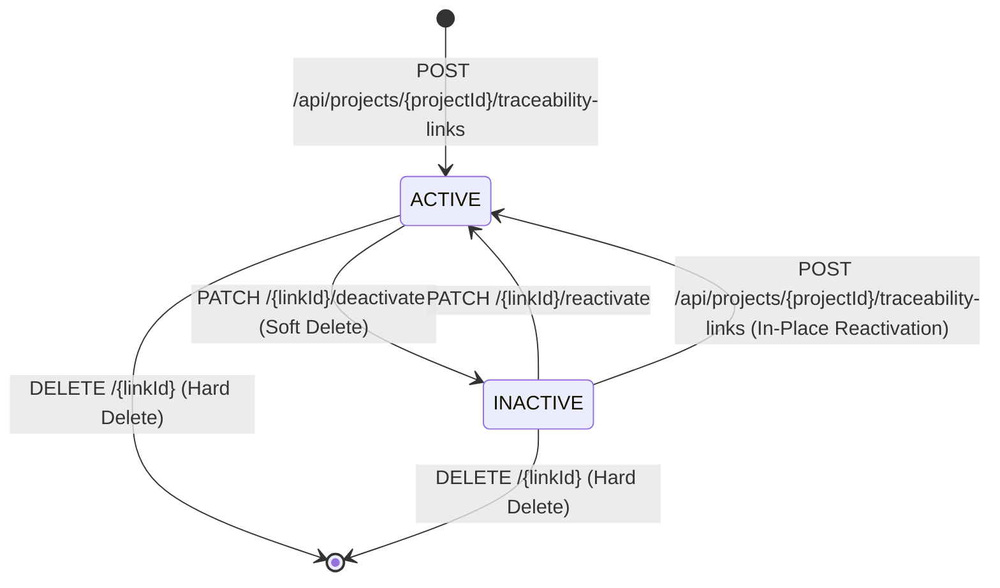

# ReqTrace AI — Feature 06.1: Traceability Link Management & Dependency Intelligence

## 1. Feature Overview

ReqTrace AI provides an AI-powered requirements evolution, traceability, and change-impact intelligence platform. Feature 06.1 establishes the enterprise-grade backend foundation for bi-directional requirements traceability and relationship dependency tracking.

Key capabilities include:
- **Bi-Directional Traceability:** Connect requirements with dependent requirements, test cases, code references, GitHub commits, and pull requests.
- **Single-Document Logical Relationship Model:** Represents each distinct logical relationship as a single document in MongoDB, managing lifecycle transitions between `ACTIVE` and `INACTIVE` states without unbounded duplicate record creation.
- **Cycle Prevention:** High-performance graph traversal (Breadth-First Search) for directional relationships (`DEPENDS_ON`, `BLOCKS`) preventing circular dependencies across active project links while permitting valid acyclic Directed Acyclic Graphs (DAGs).
- **In-Place Reactivation:** Re-linking an inactive relationship reactivates the existing document in place rather than creating duplicate historical records.
- **Project Isolation & Security:** Strict project-level authorization, mass-assignment prevention, validated DTO contracts, and uniform error semantics.

---

## 2. Architecture & Involved Components

### A. Backend Architecture (Spring Boot 3.3.4 & MongoDB Atlas)

- **`TraceabilityLink.java`**: Domain entity annotated with `@Document(collection = "traceability_links")`. Employs a unique compound index across `{projectId: 1, sourceArtifactType: 1, sourceArtifactId: 1, targetArtifactType: 1, targetArtifactId: 1, linkType: 1}` that excludes `status` to enforce the single-document lifecycle model.
- **Enums (`com.nova.emergency.model.enums`)**:
  - `TraceabilityArtifactType`: `REQUIREMENT`, `TEST_CASE`, `CODE_REFERENCE`, `GITHUB_COMMIT`, `GITHUB_PULL_REQUEST`.
  - `TraceabilityLinkType`: `DEPENDS_ON`, `BLOCKS`, `VERIFIED_BY`, `IMPLEMENTED_BY`, `RELATED_TO`.
  - `TraceabilityLinkStatus`: `ACTIVE`, `INACTIVE`.
- **`TraceabilityLinkRepository.java`**: Spring Data MongoDB repository providing project-scoped queries, status filters, directional queries (source/target), type filters, existence checks, and atomic delete operations.
- **DTOs (`com.nova.emergency.dto`)**:
  - `CreateTraceabilityLinkRequest`: Validates artifact types, artifact IDs, link type, and optional description. Protects against mass assignment.
  - `UpdateTraceabilityLinkRequest`: Only allows updating the relationship description; immutable identity fields are preserved.
  - `TraceabilityLinkResponse`: Standard API response envelope mapping domain fields.
- **`TraceabilityLinkService.java` & `TraceabilityLinkServiceImpl.java`**: Production service layer enforcing project authorization, requirement existence verification, directional compatibility checks, self-link rejection, in-place reactivation, and graph-based cycle detection.
- **`TraceabilityLinkController.java`**: REST controller exposing 10 project-scoped API endpoints under `/api/projects/{projectId}/traceability-links`.
- **`GlobalExceptionHandler.java`**: Centralized REST exception handler mapping validation errors to `400 Bad Request`, auth failures to `401 Unauthorized` / `403 Forbidden`, missing entities to `404 Not Found`, and state/cycle conflicts to `409 Conflict`.

---

## 3. Relationship Lifecycle & State Machine



### Lifecycle Rules:
1. **Creation:** A new relationship is created with `ACTIVE` status.
2. **Duplicate Active Rejection:** Attempting to create an active link when an active link with identical logical tuple already exists yields HTTP `409 Conflict`.
3. **In-Place Reactivation:** Attempting to create a link when an inactive record exists reactivates the inactive document in place (`status = ACTIVE`, updated timestamp and description) without creating a new record.
4. **Soft Deactivation:** `deactivate` transitions the link to `INACTIVE`. Inactive links are excluded from cycle detection and active graph traversal.
5. **Reactivation Cycle Guard:** Reactivating a link verifies that no cyclic dependencies were introduced while the link was inactive.

---

## 4. REST API Endpoints

All endpoints are scoped under:
`/api/projects/{projectId}/traceability-links`

| Method | Endpoint | Description | Request Body | Response Wrapper |
|---|---|---|---|---|
| `POST` | `/` | Create a traceability link | `CreateTraceabilityLinkRequest` | `ApiResponse<TraceabilityLinkResponse>` |
| `GET` | `/` | List project links (optional `status`, `page`, `pageSize`) | None | `ApiResponse<List<TraceabilityLinkResponse>>` |
| `GET` | `/outgoing` | Query outgoing links (`sourceArtifactType`, `sourceArtifactId`) | None | `ApiResponse<List<TraceabilityLinkResponse>>` |
| `GET` | `/incoming` | Query incoming links (`targetArtifactType`, `targetArtifactId`) | None | `ApiResponse<List<TraceabilityLinkResponse>>` |
| `GET` | `/by-type` | Query links by type (`linkType`) | None | `ApiResponse<List<TraceabilityLinkResponse>>` |
| `GET` | `/{linkId}` | Retrieve a specific link by ID | None | `ApiResponse<TraceabilityLinkResponse>` |
| `PATCH` | `/{linkId}` | Update link description | `UpdateTraceabilityLinkRequest` | `ApiResponse<TraceabilityLinkResponse>` |
| `PATCH` | `/{linkId}/deactivate` | Soft-deactivate a link | None | `ApiResponse<TraceabilityLinkResponse>` |
| `PATCH` | `/{linkId}/reactivate` | Reactivate an inactive link | None | `ApiResponse<TraceabilityLinkResponse>` |
| `DELETE` | `/{linkId}` | Permanently delete a link | None | `ApiResponse<Void>` |

---

## 5. Request & Response Examples

### A. Create Traceability Link
**`POST /api/projects/proj-100/traceability-links`**
```json
{
  "sourceArtifactType": "REQUIREMENT",
  "sourceArtifactId": "req-001",
  "targetArtifactType": "REQUIREMENT",
  "targetArtifactId": "req-002",
  "linkType": "DEPENDS_ON",
  "description": "Rescue unit dispatch requires verified incident triage."
}
```

**Response (`201 Created`):**
```json
{
  "data": {
    "id": "6745f1b2c4e3d9281a4b9981",
    "projectId": "proj-100",
    "sourceArtifactType": "REQUIREMENT",
    "sourceArtifactId": "req-001",
    "targetArtifactType": "REQUIREMENT",
    "targetArtifactId": "req-002",
    "linkType": "DEPENDS_ON",
    "status": "ACTIVE",
    "description": "Rescue unit dispatch requires verified incident triage.",
    "createdBy": "user-123",
    "createdAt": "2026-11-27T11:45:00.000Z",
    "updatedAt": "2026-11-27T11:45:00.000Z"
  },
  "success": true,
  "code": null,
  "message": "Traceability link created successfully",
  "timestamp": "2026-11-27T11:45:00.050Z",
  "meta": null
}
```

### B. List Links (Paginated)
**`GET /api/projects/proj-100/traceability-links?status=ACTIVE&page=0&pageSize=10`**

**Response (`200 OK`):**
```json
{
  "data": [
    {
      "id": "6745f1b2c4e3d9281a4b9981",
      "projectId": "proj-100",
      "sourceArtifactType": "REQUIREMENT",
      "sourceArtifactId": "req-001",
      "targetArtifactType": "REQUIREMENT",
      "targetArtifactId": "req-002",
      "linkType": "DEPENDS_ON",
      "status": "ACTIVE",
      "description": "Rescue unit dispatch requires verified incident triage.",
      "createdBy": "user-123",
      "createdAt": "2026-11-27T11:45:00.000Z",
      "updatedAt": "2026-11-27T11:45:00.000Z"
    }
  ],
  "success": true,
  "code": null,
  "message": null,
  "timestamp": "2026-11-27T11:45:01.000Z",
  "meta": {
    "total": 1,
    "page": 0,
    "pageSize": 10
  }
}
```

### C. Update Link Description
**`PATCH /api/projects/proj-100/traceability-links/6745f1b2c4e3d9281a4b9981`**
```json
{
  "description": "Updated architecture rationale: Triage verification protocol v2."
}
```

**Response (`200 OK`):**
```json
{
  "data": {
    "id": "6745f1b2c4e3d9281a4b9981",
    "projectId": "proj-100",
    "sourceArtifactType": "REQUIREMENT",
    "sourceArtifactId": "req-001",
    "targetArtifactType": "REQUIREMENT",
    "targetArtifactId": "req-002",
    "linkType": "DEPENDS_ON",
    "status": "ACTIVE",
    "description": "Updated architecture rationale: Triage verification protocol v2.",
    "createdBy": "user-123",
    "createdAt": "2026-11-27T11:45:00.000Z",
    "updatedAt": "2026-11-27T11:46:30.000Z"
  },
  "success": true,
  "code": null,
  "message": "Traceability link updated successfully",
  "timestamp": "2026-11-27T11:46:30.010Z",
  "meta": null
}
```

### D. Circular Dependency Error
**`POST /api/projects/proj-100/traceability-links`** (Attempting `req-002 -> req-001` with `DEPENDS_ON`)

**Response (`409 Conflict`):**
```json
{
  "data": null,
  "success": false,
  "code": "CONFLICT",
  "message": "Circular dependency detected: Adding a DEPENDS_ON link from 'req-002' to 'req-001' would create a cycle.",
  "timestamp": "2026-11-27T11:47:00.000Z",
  "meta": null
}
```

---

## 6. Security Hardening & Data Integrity

1. **Authentication & Identity Resolution:**
   - All endpoints enforce `@PreAuthorize("isAuthenticated()")` and Spring Security JWT filters.
   - Missing or anonymous principals are rejected with `401 Unauthorized` (`BadCredentialsException`).
   - Authenticated principal email or ID is verified against the `UserRepository`; missing accounts return `403 Forbidden`.
2. **Project Authorization & Isolation:**
   - Every operation checks project ownership (`project.getOwnerId() == authenticatedUserId`). Cross-project queries or non-member attempts return `403 Forbidden`.
   - Every database query strictly filters by `projectId`.
3. **Mass-Assignment Protection:**
   - Identifiers (`id`, `projectId`), lifecycle status (`status`), audit attributes (`createdBy`, `createdAt`, `updatedAt`), and relationship endpoints cannot be overwritten via request bodies.
4. **Denial-of-Service & Pagination Capping:**
   - Page sizes are automatically capped to `Math.min(pageSize, 100)` to guard against memory exhaustion.
5. **Validation & Type Safety:**
   - Required query parameters (`sourceArtifactType`, `sourceArtifactId`, etc.) and body fields are strictly validated, rejecting missing or invalid enums with `400 Bad Request`.
6. **Artifact Compatibility Matrix:**
   - `DEPENDS_ON` & `BLOCKS`: `REQUIREMENT` ➔ `REQUIREMENT`
   - `VERIFIED_BY`: `REQUIREMENT` ➔ `TEST_CASE`
   - `IMPLEMENTED_BY`: `REQUIREMENT` ➔ `CODE_REFERENCE`, `GITHUB_COMMIT`, `GITHUB_PULL_REQUEST`
   - `RELATED_TO`: Any supported artifact types.

---

## 7. Automated Test Suite & Coverage

The traceability module maintains an automated test suite avoiding production MongoDB Atlas connections:
- **`TraceabilityLinkModelTest.java`**: Verifies domain model annotations, builders, and unique compound index definition excluding `status`.
- **`TraceabilityLinkRepositoryTest.java`**: Verifies repository method signatures, Spring Data queries, and status filtering.
- **`CreateTraceabilityLinkRequestTest.java` & DTO tests**: Verifies Jakarta bean validations, whitespace trimming, and error messages.
- **`TraceabilityLinkServiceTest.java`**: Unit tests covering 23 business logic cases (cycle detection, project authorization, duplicate detection, in-place reactivation, DAG acceptance).
- **`TraceabilityLinkControllerTest.java`**: WebMvc controller tests covering 28 HTTP endpoint responses and validation branches.
- **`TraceabilityLinkIntegrationTest.java`**: End-to-end integration slice connecting Controller, real Service, and repository mocks across complete 10-step lifecycles, security boundaries, and edge cases.

---

## 8. Known Limitations & Future Work

- **External Artifact Existence Verification:** While `REQUIREMENT` artifacts are strictly validated against MongoDB in the project scope, external artifact types (`TEST_CASE`, `CODE_REFERENCE`, `GITHUB_COMMIT`, `GITHUB_PULL_REQUEST`) are validated for enum compatibility and format. Direct existence checks in external VCS/CI systems will be provided by dedicated VCS integration plugins in future releases.
- **Frontend UI:** User-facing traceability matrices, dependency graph visualizations, and link editors are scheduled for subsequent frontend tasks.
